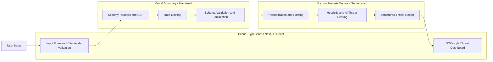

<div align="center">

# SentinelAI

**Real-time threat analysis that turns SOC-grade signals into plain-English decisions.**

<br>

[](https://sentinel-ai-theta-cyan.vercel.app/)
[](#language-breakdown)
[](#language-breakdown)
[](https://sentinel-ai-theta-cyan.vercel.app/)
[](#under-the-hood-security-hardening--defensive-engineering)

<br>

[](https://sentinel-ai-theta-cyan.vercel.app/)

</div>

---

## Overview: Why SentinelAI?

**In simple terms:** you give SentinelAI something suspicious, and it tells you whether it looks dangerous, why it looks that way, and what to do about it. No security background required.

**Why it exists:** professional security tools are built for analysts who already know how to read raw alerts, logs, and indicators. Everyone else gets a wall of jargon or nothing at all. SentinelAI closes that gap. It runs the kind of pattern-based analysis a Security Operations Center (SOC) relies on and explains the result clearly enough that a beginner can act on it and an analyst can still trust it.

**What it does:**

- Analyzes inputs for threats, vulnerabilities, and malicious patterns
- Scores severity and explains the reasoning behind each verdict
- Returns structured, actionable security intelligence in real time
- Presents everything in a dark-mode, SOC-style dashboard that works on desktop and mobile

---

## Try It Live: 30-Second Beginner's Walkthrough

You do not need to install anything or write any code.

**Step 1 - Open the app.**
Click the launch button below. The dashboard loads in your browser.

[](https://sentinel-ai-theta-cyan.vercel.app/)

**Step 2 - Paste a sample input.**
Copy one of the harmless test inputs below into the analysis box and submit it.

| Try this | What it simulates |
|---|---|
| `http://secure-login-paypa1.com/verify?account=update` | A phishing-style link with a lookalike domain |
| `<script>alert(1)</script>` | A classic script-injection test string |
| `https://github.com` | A normal, legitimate address, for comparison |

These are standard demonstration strings. Nothing here is harmful to run.

**Step 3 - Read the result.**
Every analysis comes back in the same shape, so you can learn to read it once and reuse that skill:

- **Severity:** how risky the input looks, from low to high
- **Why it was flagged:** the specific patterns or indicators that triggered the verdict
- **What to do next:** plain-language recommended actions

Try the suspicious samples first, then the clean one. Seeing the difference is the fastest way to understand what the tool is looking for.

---

## Key Features & Threat Intelligence Capabilities

| Capability | What it gives you |
|---|---|
| **Real-time analysis** | Results return in seconds through a serverless Python analysis engine |
| **Hybrid detection** | AI-assisted scoring combined with deterministic heuristics, so verdicts are explainable and not a black box |
| **Malicious pattern recognition** | Detection of injection payloads, suspicious links, and common vulnerability indicators |
| **Explainable output** | Every verdict includes the evidence behind it and a recommended response |
| **Structured threat intelligence** | Consistent, typed results that are easy to read, compare, and build on |
| **SOC-style dashboard** | A dark-mode, responsive interface built with Next.js and React |
| **Hardened by default** | Strict CSP, security headers, input sanitization, and API rate limiting in production |

---

## System Architecture & Language Breakdown

SentinelAI is a hybrid application. A strictly typed Next.js frontend handles interaction and presentation, and a Python engine handles the analysis. Vercel hosts both: the frontend as a Next.js app and the backend as serverless functions.



### Language Breakdown

```text
TypeScript  ██████████████████████████████░░░░░░░░░░░░░░░░░░░░  59.0%
Python      ███████████████████░░░░░░░░░░░░░░░░░░░░░░░░░░░░░░░  37.5%
CSS         █░░░░░░░░░░░░░░░░░░░░░░░░░░░░░░░░░░░░░░░░░░░░░░░░░   1.8%
JavaScript  █░░░░░░░░░░░░░░░░░░░░░░░░░░░░░░░░░░░░░░░░░░░░░░░░░   1.7%
```

| Language | Share | What it powers |
|---|---|---|
| **TypeScript** | 59.0% | Next.js / React frontend, strict type-safety across the UI, request and response contracts, and the interactive security dashboard |
| **Python** | 37.5% | Core backend intelligence: the AI and heuristic threat analysis engine and automated security scripts |
| **CSS** | 1.8% | Modern, responsive dark-mode SOC-style interface |
| **JavaScript** | 1.7% | Utility and configuration scripts |

The split reflects the design. TypeScript keeps the user-facing layer predictable and safe to change, and Python keeps the detection logic where security tooling and analysis libraries are strongest.

<details>
<summary><b>Deep dive: the TypeScript-to-Python data pipeline</b></summary>

<br>

1. **Capture.** The Next.js client collects the input and applies first-pass validation (type, length, and format checks) so malformed requests never leave the browser.
2. **Typed request.** The client sends the payload to a serverless API route over HTTPS using a typed contract, which keeps both sides of the pipeline in agreement about shape.
3. **Boundary controls.** Before any analysis runs, the request passes through rate limiting and server-side schema validation. Client-side checks are treated as convenience, never as trust.
4. **Sanitization and normalization.** The Python engine strips or neutralizes dangerous constructs and normalizes the input (encoding tricks, casing, whitespace) so detection operates on a canonical form and cannot be bypassed by obfuscation.
5. **Detection.** Deterministic heuristics match known malicious patterns. AI-assisted scoring then weighs the combined signals and produces a severity and confidence assessment.
6. **Structured report.** The engine returns a structured result: severity, confidence, matched indicators, a plain-language explanation, and recommended actions.
7. **Render.** The dashboard validates the response against the expected type before rendering it. Output is escaped on display so analyzed content can never execute in the viewer's browser.

Keeping heuristics and AI scoring side by side is intentional. Heuristics give repeatable, auditable verdicts, and the AI layer improves coverage on inputs that rules alone would miss.

</details>

---

## Under the Hood: Security Hardening & Defensive Engineering

A security tool should hold itself to the standard it recommends. SentinelAI is built with these controls in production.

| Control | Purpose |
|---|---|
| **Content Security Policy (CSP)** | Restricts which sources can load scripts, styles, and connections, limiting the impact of any injected content |
| **HTTP security headers** | Hardens browser behavior against clickjacking, MIME sniffing, protocol downgrade, and unwanted referrer leakage |
| **Input sanitization** | Defends against XSS and injection at the edge and again inside the Python engine |
| **Schema validation** | Rejects malformed or unexpected payloads before they reach analysis logic |
| **Rate limiting and API safety** | Reduces abuse, scraping, and resource exhaustion on the serverless endpoints |
| **Output encoding** | Analyzed content is displayed as inert text and never interpreted as markup |
| **Least-exposure design** | The API surface is kept small, and error responses avoid leaking internals |

### OWASP Top 10 Alignment

| OWASP risk category | How SentinelAI addresses it |
|---|---|
| **Injection (including XSS)** | Layered validation, sanitization, and output encoding on both client and server |
| **Security Misconfiguration** | Hardened headers and CSP applied by default in the deployed environment |
| **Insecure Design** | Trust boundaries are explicit, and the client is never trusted to validate on its own |
| **Vulnerable and Outdated Components** | Dependencies are kept minimal and managed through lockfiles |

<details>
<summary><b>Reference: security headers applied in production</b></summary>

<br>

| Header | Role |
|---|---|
| `Content-Security-Policy` | Controls permitted content sources and blocks inline and third-party script abuse |
| `Strict-Transport-Security` | Forces HTTPS and prevents protocol downgrade |
| `X-Content-Type-Options: nosniff` | Stops browsers from guessing content types |
| `X-Frame-Options: DENY` | Prevents the app from being embedded in hostile frames |
| `Referrer-Policy` | Limits URL information shared with other sites |
| `Permissions-Policy` | Disables browser features the app does not need |

</details>

---

## Local Development Setup

<details>
<summary><b>Expand for full installation instructions</b></summary>

<br>

**Prerequisites:** Node.js 18.18 or newer, Python 3.10 or newer, and `git`.

**1. Get the code**

Clone the repository from GitHub using the green **Code** button, then open a terminal in the project folder:

```bash
cd SentinelAI
```

**2. Install frontend dependencies (TypeScript / Next.js)**

```bash
# with npm
npm install

# or with pnpm
pnpm install
```

**3. Set up the Python backend**

```bash
python -m venv .venv

# macOS / Linux
source .venv/bin/activate

# Windows (PowerShell)
.venv\Scripts\Activate.ps1

pip install -r requirements.txt
```

**4. Run the full stack (frontend and Python serverless functions)**

```bash
npm install -g vercel
vercel dev
```

**5. Or run the frontend alone**

```bash
npm run dev
# or
pnpm dev
```

Open [http://localhost:3000](http://localhost:3000) in your browser.

**Production build check**

```bash
npm run build
```

</details>

---

## Ethical Use & Responsible Disclosure

SentinelAI is built for **defensive analysis, education, and authorized security testing**. Use it only on systems, applications, and data you own or have explicit written permission to assess. The authors do not condone and are not responsible for misuse, including unauthorized testing, attacks, or any illegal activity.

If you find a security issue in SentinelAI itself, please report it responsibly:

- Use the repository's **Security** tab to report the issue privately
- Include clear reproduction steps and the potential impact
- Allow reasonable time for a fix before any public disclosure

Good-faith research and responsible reporting are welcome and appreciated.

---

## Author & Connect

**Jyotipriyo Saha**  
Founder at Three Pixels | Cybersecurity Practitioner

SentinelAI was designed and built to make threat analysis understandable without watering it down. If you have feedback, ideas, or want to collaborate, open an issue or start a discussion on this repository.

[](https://sentinel-ai-theta-cyan.vercel.app/)
